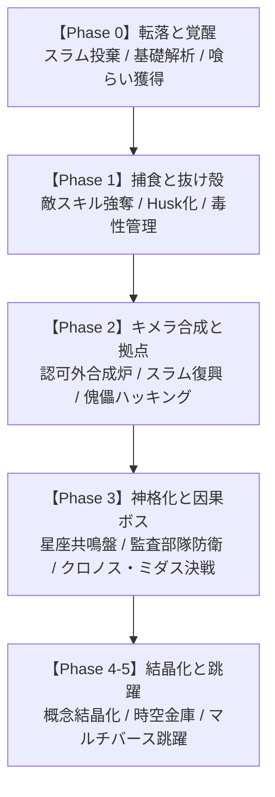
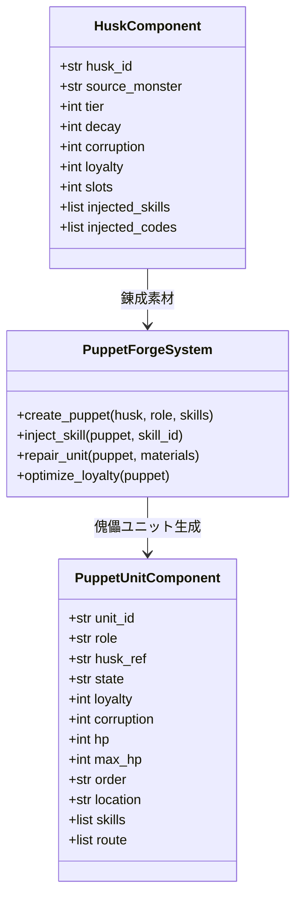
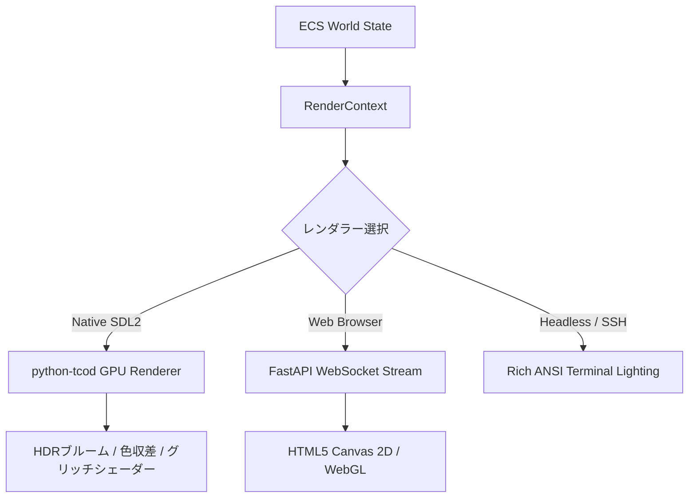

# 🌌 naRou: Masterpiece Edition & Multi-World Architecture
## ⚔️ Aの世界：スキル喰い（Skill Eater RPG）完全統合・極致版仕様書

<p align="center">
  
  
  
  
  
  
</p>

---

## 📑 目次 (Table of Contents)

1. [プロジェクト概要と基本理念](#1-プロジェクト概要と基本理念)
2. [ゲーム世界観・ナラティブ設定（Aの世界：スキル喰い）](#2-ゲーム世界観ナラティブ設定aの世界スキル喰い)
3. [ゲームプレイ・フローと全フェーズ進行詳細](#3-ゲームプレイフローと全フェーズ進行詳細)
   - [Phase 0: 転落と覚醒（Betrayal & Awakening）](#phase-0-転落と覚醒betrayal--awakening)
   - [Phase 1: 禁忌の《喰らい》と抜け殻（Devour & Husk）](#phase-1-禁忌の喰らいと抜け殻devour--husk)
   - [Phase 2: キメラ合成炉とスラム拠点復興（Chimera Synthesis & Slum Base）](#phase-2-キメラ合成炉とスラム拠点復興chimera-synthesis--slum-base)
   - [Phase 3: 神格化アセンションと因果律ボス決戦（Ascension & Causal Bosses）](#phase-3-神格化アセンションと因果律ボス決戦ascension--causal-bosses)
   - [Phase 4-5: 概念結晶化とマルチバース次元跳躍（Concept Crystallization & Multiverse Leap）](#phase-4-5-概念結晶化とマルチバース次元跳躍concept-crystallization--multiverse-leap)
4. [コアシステム詳説](#4-コアシステム詳説)
   - [4.1 スキル強奪・捕食（Devour Engine）＆ 毒性侵食（Toxicity System）](#41-スキル強奪捕食devour-engine-毒性侵食toxicity-system)
   - [4.2 抜け殻（Husk）傀儡化・フォージ・ユニット使役（Husk Puppet Hacking）](#42-抜け殻husk傀儡化フォージユニット使役husk-puppet-hacking)
   - [4.3 キメラ合成炉（Chimera Synthesis Forge）とプロシージャル魔導合成](#43-キメラ合成炉chimera-synthesis-forgeとプロシージャル魔導合成)
   - [4.4 メタシナリオ介入（Meta Scenario Intervention / なろうテンプレ粉砕）](#44-メタシナリオ介入meta-scenario-intervention--なろうテンプレ粉砕)
   - [4.5 タワーディフェンス型スラム防衛戦（Babel Audit Defense）](#45-タワーディフェンス型スラム防衛戦babel-audit-defense)
   - [4.6 CQCT (Condition AST) ＆ 非線形DAGクエストシステム](#46-cqct-condition-ast-非線形dagクエストシステム)
   - [4.7 因果律書き換え・輪廻転生エンジン（Global Rule Engine & Reincarnation）](#47-因果律書き換え輪廻転生エンジンglobal-rule-engine--reincarnation)
   - [4.8 陣形AI・意図予測（Intent Prediction & Formation Behavior Tree）](#48-陣形ai意図予測intent-prediction--formation-behavior-tree)
5. [クラシック naRou Core システム（Elona風サンドボックス基盤）](#5-クラシック-narou-core-システムelona風サンドボックス基盤)
   - [5.1 ECS（Entity Component System）アーキテクチャ](#51-ecsentity-component-systemアーキテクチャ)
   - [5.2 ペット育成・遺伝・騎乗・交配・性格システム](#52-ペット育成遺伝騎乗交配性格システム)
   - [5.3 信仰・神格降臨システム（Pantheon & Tribute）](#53-信仰神格降臨システムpantheon--tribute)
   - [5.4 プロシージャル・ダンジョン生成＆地形破壊エンジン](#54-プロシージャルダンジョン生成地形破壊エンジン)
   - [5.5 経済・闇市場・鑑定・考古学・農業・釣りシステム](#55-経済闇市場鑑定考古学農業釣りシステム)
6. [UI/UX・レンダリング・オーディオアーキテクチャ](#6-uiuxレンダリングオーディオアーキテクチャ)
   - [6.1 レンダリングパイプライン（tcod / Canvas / WebGL / HDR / ターミナルライティング）](#61-レンダリングパイプラインtcod--canvas--webgl--hdr--ターミナルライティング)
   - [6.2 VFX・パーティクルシステム＆サイバーAR HUD](#62-vfxパーティクルシステムサイバーar-hud)
   - [6.3 音響・シンセ Foley SE エンジン](#63-音響シンセ-foley-se-エンジン)
   - [6.4 Webブラウザ版（FastAPI ＋ WebSocket / HTML5 Canvas）](#64-webブラウザ版fastapi--websocket--html5-canvas)
7. [データ構造・ファイルフォーマット仕様](#7-データ構造ファイルフォーマット仕様)
   - [7.1 クエスト・ナラティブ定義（YAML / DAG）](#71-クエストナラティブ定義yaml--dag)
   - [7.2 テンプレ定義（Archetype, Exploit Windows, Rewards）](#72-テンプレ定義archetype-exploit-windows-rewards)
   - [7.3 監査ユニット・防衛兵科定義（Audit Units）](#73-監査ユニット防衛兵科定義audit-units)
   - [7.4 セーブデータ構造と暗号化・改ざん防止（Anti-Cheat & Serialization）](#74-セーブデータ構造と暗号化改ざん防止anti-cheat--serialization)
8. [完全キーバインド＆操作リファレンス](#8-完全キーバインド操作リファレンス)
9. [ディレクトリ構成・モジュールマップ](#9-ディレクトリ構成モジュールマップ)
10. [開発・テスト・ベンチマーク・品質保証ガイド](#10-開発テストベンチマーク品質保証ガイド)
11. [ロードマップとマルチバース拡張計画](#11-ロードマップとマルチバース拡張計画)
12. [コントリビューション規約とライセンス](#12-コントリビューション規約とライセンス)

---

## 1. プロジェクト概要と基本理念

**naRou (ナロウ)** は、名作ローグライク『Elona』の持つ圧倒的な自由度・創発的サンドボックス・緻密な育成・生活・信仰・ペットシステムを極限までリスペクトしつつ、最先端の**ECS（Entity Component System）設計**と**マルチバース世界線構想**を融合させた究極の次世代型オープンワールド・ローグライクRPGエンジンです。

本作の中心柱となる**『Aの世界：スキル喰い（Skill Eater RPG）』**では、従来の「レベルアップして固定スキルを習得する」成長システムを完全解体。「敵の肉体と魂からスキルを直接引き裂いて強奪する（Devour）」「認可外の魔導炉で掛け合わせて禁忌のキメラスキルを錬成する」「魂を抜かれた敵の抜け殻（Husk）を再プログラムして自律傀儡軍団を編成する」「物語のお約束（なろうテンプレ）を読者視点のメタ知識で粉砕して因果律ポイントを裁定収穫する」といった、ナラティブとシステムが完全一致した前代未聞のダークサイバー・ローグライク体験を提供します。

### 🌟 開発設計思想（Five Pillars）
1. **創発的自由度 (Emergent Gameplay)**:
   世界のあらゆる要素が物理・化学・属性・因果のルールで相互接続。壁を掘削してショートカットを作り、氷属性で水路を凍らせて進軍し、敵の魂を抜いて拠点警備タレットへ変換する自由をプレイヤーに委ねます。
2. **ナラティブとメカニクスの完全同期 (Ludonarrative Resonance)**:
   ストーリー上の主人公の能力（スキル喰らい、因果改変、原典閲覧）が、そのままキー入力可能なゲームプレイ機構としてコード化されています。
3. **メタ構造とマルチバース (Metaverse & Reincarnation)**:
   1つの世界をクリアして終わりではなく、魂に刻んだ「概念結晶（Concept Crystal）」を時空金庫に収め、法則の異なる次の世界（Bの世界：錬金術の深淵、Cの世界：電子都市など）へと跳躍する輪廻転生ループ。
4. **堅牢なECS＆モジュラー・パッケージ構造 (Robust Clean Architecture)**:
   スパゲッティコードを排除し、疎結合なコンポーネント、イベントバス、DIコンテナ、明確なパッケージ境界（`naRou.systems.*`, `naRou.ecs.*`, `naRou.ui.*`）によって高い保守性と拡張性を維持。
5. **完全自動検証＆高品質テストカバレッジ (Zero-Defect Standard)**:
   全サブシステム、ASTパルサー、防衛シミュレータ、傀儡ハッキング、メタ介入エンジンに至るまで、網羅的な単体・結合テストスイートを配備。

---

## 2. ゲーム世界観・ナラティブ設定（Aの世界：スキル喰い）

### 🏙️ 舞台：巨大企業都市『バベル（Babel Tower）』と深度700mの廃棄スラム
雲を突き抜ける超高層階層都市「バベルタワー」。そこは**ミダス商会**を中心とする巨大複合企業群が「スキル＝市民権・資産・生命維持権」として全てを独占管理する徹底した格差社会でした。

主人公は、バベルタワーの若きエリート監査官。上層部が推し進める「禁忌の因果律改変計画」の不正証拠を掴んだ瞬間、同僚と上層部の罠に嵌められ、所有する全公認スキルと生体認証コードを永久剥奪（パージ）されます。そして、生きて戻る者はいないとされる深度700mの廃棄スラム「最下層セクター・オメガ」へと投棄されたのでした。

### 🩸 目覚めし禁忌の力：《喰らい（Devour）》
廃棄汚泥の中で死に瀕した主人公が手に入れたのは、最底辺の廃棄ゴミスキル《基礎解析（Scan）》と、自らの肉体を認可外魔導炉とする禁忌のウイルスコード**《喰らい（Devour）》**でした。
他者のスキル核を直接貪り喰らうことで、自己の魂をアップデートし、世界の因果律すらハッキングしていく——。

スラムのレジスタンス「解放戦線」の仲間たち（隻眼のハッカー・エルザ、義肢の武器職人・バルボア、記憶を失ったアンドロイド・ノア）と出会い、主人公は奪われたすべてを取り戻すため、バベルタワー最上層「第0因果律執行神」への復讐と世界の解放を開始します。

---

## 3. ゲームプレイ・フローと全フェーズ進行詳細

本作はプロシージャル生成されるダンジョンと拠点を行き来しながら、全5大フェーズを通じて段階的に世界とシステムの全貌が明かされていきます。



### Phase 0: 転落と覚醒（Betrayal & Awakening）
- **チュートリアル・脱出劇**:
  プレイヤーはステータス全損・スキル0の状態から開始。瓦礫の中から《基礎解析（Scan）》を拾い上げ、追捕犬（Babel Hound）の行動意図と弱点（電撃属性・核露出タイミング）をスキャン。
- **初捕食**:
  瀕死の追捕犬に対し `V` キーで《喰らい（Devour）》を発動。《獣の跳躍》と《嗅覚追跡》を体内に直接コード注入。生体機能を取り戻して包囲網を突破します。

### Phase 1: 禁忌の《喰らい》と抜け殻（Devour & Husk）
- **スキルの強奪・永続習得**:
  ダンジョン内の全エネミー（スライム、ゴブリン、暗殺ドローン、バベル警備兵）はそれぞれ固有スキルを持っています。HPを20%以下に削り《喰らい》を成功させると、敵スキルを即座に自分のスロットへ永続追加。
- **抜け殻（Husk）の発生**:
  スキルを強奪された敵は即座に死亡せず、魂と意志を吸い取られた白濁の肉体「抜け殻（Husk）」へと退化します。
- **スキル拒絶反応（Toxicity）の管理**:
  無計画な捕食は体内に「異質コード毒性（Toxicity）」を蓄積させます。毒性ゲージが80%を超えると毎ターン拒絶スリップダメージが発生し、最大HPが低下。セーフハウスでの急速デトックス、中和ポーションの調合、または適応スキルの習得が必要です。

### Phase 2: キメラ合成炉とスラム拠点復興（Chimera Synthesis & Slum Base）
- **認可外キメラ合成炉 (`Shift + T`)**:
  スラムの地下工房に眠る「キメラ合成炉」を復旧。強奪した余剰スキル2種を掛け合わせ、未知のシナジーを持つ上位スキルをプロシージャル錬成します。
  - 例:《初級火炎（Fireball）》×《思考加速（Acceleration）》＝《変異融合：業火の超思考（Inferno Hyper-Mind）》
- **傀儡ハッキング（Husk Puppet Hacking）**:
  回収したHuskに余剰スキルを再注入し、自律戦闘ドローン、拠点迎撃タレット、資材回収ユニットとしてプログラミング。
- **スラム拠点投資**:
  略奪物資や資金をスラムに投資し、地下闇市場、医療ステーション、防衛バリケードを建設・拡張。

### Phase 3: 神格化アセンションと因果律ボス決戦（Ascension & Causal Bosses）
- **神格化星座盤（Ascension Constellation Board）**:
  マスタースキルを星座グリッド（Void, Flame, Lightning, Bio, Cyber, Light）に配置。隣接ノード間の属性共鳴リンクによって、常識を超えた超常パッシブ能力（全魔法CT短縮90%、即死無効化、時空停止など）を開花。
- **バベル監査執行部隊の迎撃（Audit Defense）**:
  プレイヤーの脅威度（Threat Level）上昇に伴い、バベルタワーから派遣される第1〜第5監査執行部隊をタワーディフェンス形式でスラム拠点にて迎撃。部隊長（監査官）を捕食して最高権限スキルを強奪。
- **因果律執行神『クロノス・ミダス』決戦**:
  タワー最上層ペントハウスにて、時間を巻き戻し確率を歪める神格ボスと対峙。《概念喰らい（Concept Devour）》によって敵の「時間遡行スキル」そのものを戦闘中に奪い去り、因果の檻を破壊。

### Phase 4-5: 概念結晶化とマルチバース次元跳躍（Concept Crystallization & Multiverse Leap）
- **概念結晶化（Concept Crystallization）**:
  同系統の極大スキル3つを、次元を超えて持ち越せる唯一の形態「概念結晶（Concept Crystal）」へと超圧縮・結晶化。
- **時空金庫（Temporal Vault）への保存**:
  獲得した概念結晶を最大5枠まで時空金庫に登録。
- **次元跳躍ゲート起動**:
  Aの世界のスラム民に自治権と自由を取り戻させた後、主人公は世界の境界線を突破。次なる異世界（Bの世界：錬金術の深淵 / Cの世界：超電脳世界）へと記憶と結晶を携えて旅立ちます。

---

## 4. コアシステム詳説

### 4.1 スキル強奪・捕食（Devour Engine）＆ 毒性侵食（Toxicity System）

捕食システムは `naRou/systems/skill_eater_system.py` により駆動される本作の根幹です。

```text
[敵モンスター発見] ──> [Xキー: 深度解析(Scan)] ──> [弱点・所持スキル・捕食成功率算出]
                             │
                             ▼ (HPを削る & 弱体化)
[隣接位置で Vキー: 喰らい(Devour) 実行]
       │
       ├─ [成功] ──> 敵スキルを完全強奪 & スロットへ永続習得
       │              敵は Husk(抜け殻) 化
       │              Toxicity(毒性ゲージ) がスキルTierに応じて上昇
       │
       └─ [失敗] ──> 敵が暴走反撃(Counter Strike) & 捕食クールダウン発生
```

#### 捕食確率計算式
$$\text{SuccessRate} = \left( 1.0 - \frac{\text{Enemy.HP}}{\text{Enemy.MaxHP}} \right) \times \text{BaseModifier} + \text{Player.SkillEaterLevel} \times 0.05 - \text{SkillTierPenalty}$$

- **状態異常ボーナス**: 敵がスタン（Stun）、凍結（Freeze）、混乱（Confuse）状態の場合、捕食成功率に +25% のボーナスが加算。
- **毒性（Toxicity）リスク**:
  - `0% - 49%`: 安定状態（副作用なし）
  - `50% - 79%`: 軽度拒絶（自然回復力 -50%、消費マナ +20%）
  - `80% - 99%`: 重度拒絶（毎ターン最大HPの5%スリップダメージ、被ダメージ +30%）
  - `100%`: 崩壊状態（強制スタン＆ランダムスキルの暴走）

---

### 4.2 抜け殻（Husk）傀儡化・フォージ・ユニット使役（Husk Puppet Hacking）

`naRou/systems/skill_eater_husk_*` サブシステム群により、倒した敵の魂の抜け殻を戦術ユニットへ再構築します。



#### 傀儡ユニットの3大兵科と命令モード
1. **護衛スレイブ (Escort Guardian)**:
   - プレイヤーに常に追従（`follow`）。敵が接近すると挑発スキルでヘイトを集め、近接物理シールドを展開してプレイヤーへの被弾を肩代わり。
2. **迎撃タレット (Defense Turret)**:
   - スラム拠点やダンジョンの要所に固定配置（`hold`）。注入された遠隔魔法スキル（火炎放射、レーザー、冷気波）で侵入エネミーを自動迎撃。
3. **回収ドローン (Scavenger Drone)**:
   - 指定したパトロールルート（`route: list[str]`）を自動巡回。ドロップアイテム、廃品マテリアル、Huskの回収を行い、セーフハウスの倉庫へ自動納入。

#### 侵食度（Corruption）と忠誠度（Loyalty）
傀儡ユニットは稼働し続けると侵食度（Corruption）が上昇します。拠点の「充電ポッド（Charging Pod）」で休息させることで侵食度を中和し、プレイヤーへの忠誠度（Loyalty）を向上させ、ステータス補正倍率を高めます。

---

### 4.3 キメラ合成炉（Chimera Synthesis Forge）とプロシージャル魔導合成

2つの異なるスキルを融合させ、両者の特性を受け継いだ上位キメラスキルを錬成するシステムです。

| スキルA (ベース) | スキルB (触媒) | 合成キメラスキル | 効果特性 |
| :--- | :--- | :--- | :--- |
| **《初級火炎球》** (Flame) | **《思考加速》** (Cyber) | **《業火の超思考》** | 魔法詠唱速度+100%、火炎弾が敵を自動追尾して連鎖爆発 |
| **《吸血牙》** (Bio) | **《電磁パルス》** (Cyber) | **《ナノドレインEMP》** | 周囲全機械敵を行動不能にしつつ、プレイヤーのHPとシールドを全回復 |
| **《シャドウステップ》** (Void) | **《氷霜陣》** (Cold) | **《絶対零度の残影》** | テレポート通過軌道上の地面を瞬時に絶対零度で凍結・敵を拘束 |
| **《重力波》** (Void) | **《神聖治癒》** (Light) | **《特異点再生フィールド》** | 敵を中心へ強制吸引しつつ、味方には毎秒リジェネを付与 |

---

### 4.4 メタシナリオ介入（Meta Scenario Intervention / なろうテンプレ粉砕）

『なろう系ファンタジー』における数々の定番お約束（テンプレフラグ）を、プレイヤーが「原典閲覧（Reader's Privilege）」のメタ視覚で事前検知し、因果をねじ曲げて崩壊させる画期的システムです（`naRou/systems/skill_eater_meta_intervention_system.py`）。

```text
[探索中・NPCスキャン] ──> [原典閲覧(Reader's Privilege): テンプレ予兆検知]
                                    │
       ┌────────────────────────────┼────────────────────────────┐
       ▼                            ▼                            ▼
【T1: 表面介入】              【T2: 構造介入】              【T3: 概念粉砕】
(例: 追放前スキル買い叩き)     (例: 婚約破棄の逆転)          (例: ざまぁ因果を丸ごと捕食)
・低リスク/小報酬              ・中リスク/中報酬             ・高リスク/世界改変
・ゴールド & 基礎因果          ・専用ユニーク称号            ・神話スキル & 因果律Point大量獲得
```

#### 収録テンプレート一覧 (`data/templates/*.yaml`)
- `expel_incompetent.yaml`: **無能追放テンプレ**（パーティを追放された少年に先回りし、真の覚醒スキルを格安で事前買い取り）
- `engagement_break.yaml`: **婚約破棄テンプレ**（断罪イベントの直前に割って入り、破棄する側の不正証拠を公表して破棄の因果を逆転）
- `credit_steal.yaml`: **手柄横取りテンプレ**（横取り貴族が討伐報告を行う前にギルド全通信をジャックして真実を世界配信）
- `betray.yaml`: **裏切りテンプレ**（裏切りを企む仲間を事前にHusk化して完全服従スレイブへ書き換え）
- `genius_discrimination.yaml`: **天才差別テンプレ**（無能判定された落ちこぼれにキメラコードを移植して学園序列を崩壊）
- `servant_conversion.yaml`: **眷属化テンプレ**（魔王の眷属化契約呪文を上書きハッキングして魔王軍幹部を使役）

---

### 4.5 タワーディフェンス型スラム防衛戦（Babel Audit Defense）

バベルタワーの治安維持機関「強制監査執行部隊」がスラム拠点を襲撃する本格迎撃戦（`naRou/skill_eater/skill_eater_audit_defense.py`）。

```mermaid
graph LR
    subgraph "バベル侵攻ルート"
        E1[第1波: 清掃執行隊] --> B[バリケード / トラップ網]
        E2[第2波: 治安執行隊] --> B
        E3[第3波: 浄化執行隊] --> B
        E4[第4波: 枢機執行隊] --> B
        E5[第5波: 審判執行部隊] --> B
    end
    B --> T[Husk迎撃タレット群]
    T --> P[プレイヤー & 護衛スレイブ]
    P --> C[スラム防衛コア (闇市場核)]
```

#### 監査執行部隊の階層と強奪可能スキル
- **第1層 清掃執行隊**: 警備ドローン・雑兵掃討。強奪可能スキル:《掃討優先度》
- **第2層 治安執行隊**: 抑圧シールド兵・スナイパー。強奪可能スキル:《臨界制圧（スタン耐性）》
- **第3層 浄化執行隊**: 炎上火炎放射兵・毒性散布部隊。強奪可能スキル:《浄化フィールド（状態異常無効）》
- **第4層 枢機執行隊**: 反捕食重装甲兵・ハッキング妨害機。強奪可能スキル:《執行権限：即死無効化》
- **第5層 審判執行部隊**: 執行官直轄の最終殲滅部隊。強奪可能スキル:《審判の令（因果律強制停止）》

---

### 4.6 CQCT (Condition AST) ＆ 非線形DAGクエストシステム

従来の線形クエストチェーンを完全撤廃し、S式ベースの条件記述言語（DSL）によるAST評価エンジンと、有向非巡回グラフ（DAG）による分岐ナラティブを採用。

#### CQCT DSL 構文例
```lisp
;; 王国名声50以上 かつ 孤児救出フラグ保持 かつ レベル20以上
(and 
  (>= player.faction_rep.kingdom 50) 
  (has flags.rescued_orphans) 
  (>= player.level 20))
```

#### 非線形並行クエスト構造
- `prerequisite_quest_ids: list[str]`: 複数の前提クエストがすべて完了した時点で自動解放。
- `is_parallel: true`: メインラインの進行をブロックせず、複数の派閥クエストやサイドストーリーを並行進行可能。
- `phase_unlock_condition`: ワールドフェーズの移行をDSL条件式で厳密に制御。

---

### 4.7 因果律書き換え・輪廻転生エンジン（Global Rule Engine & Reincarnation）

ゲーム内で獲得した「因果律ポイント（Karma Points）」を消費して、ゲーム全体の基本ルールそのものを恒久的に書き換えるメタ機能です。

```python
# グローバルルールの書き換え実行例
rule_engine.override_rule(
    rule_name="permadeath_protection",
    value=True,
    cost_type="KARMA",
    available_karma=player.karma_points
)
```

- **書き換え可能なワールドルール**:
  - `shop_discount_rate`: 全闇市場の取引価格を恒久的に半減
  - `devour_success_bonus`: 捕食成功率に基礎 +20% の底上げ
  - `toxicity_decay_multiplier`: 毒性の自然減衰速度を3倍に加速
  - `husk_max_slots`: 傀儡ユニットのスロット上限を解放

---

### 4.8 陣形AI・意図予測（Intent Prediction & Formation Behavior Tree）

敵AIは単純な接近殴りではなく、ロールに応じた戦術的陣形（Formation）と行動ツリー（Behavior Tree）を実行します。

- **意図予測HUD（Intent Telegraphing）**:
  敵の頭上に次回行動アイコンがリアルタイム表示されます。
  - ⚔ **突撃 (Assault)**: 次ターン直線強打攻撃
  - ✷ **詠唱 (Casting)**: 範囲魔法のチャージ中（攻撃範囲マスが赤くハイライト）
  - ➛ **牽制・後退 (Kiting)**: 間合いを保ちながら遠隔狙撃
  - ✚ **回復・防護 (Support)**: 仲間の回復またはシールド展開
- **陣形協調**:
  タンク役が前面で壁を作り、背後からアーチャーやメイジが射線を通し、アサシンがプレイヤーの背後へ回り込む連携を展開。

---

## 5. クラシック naRou Core システム（Elona風サンドボックス基盤）

### 5.1 ECS（Entity Component System）アーキテクチャ
全てのゲーム内オブジェクト（プレイヤー、敵、ペット、アイテム、家具、ダンジョンタイル、投射物）は `Entity` と複数のデータ `Component` の組み合わせで構成されています。

```text
Entity (UUID)
  ├── AttributesComponent (筋力, 耐久, 器用, 感覚, 習得, 意思, 魔力, 魅力)
  ├── BaseStatsComponent (HP, MP, SP, 速度, 物理防御, 魔法防御)
  ├── HuskInventoryComponent (捕獲したHuskコレクション)
  ├── SkillFusionComponent (キメラ合成炉データ)
  ├── StatusEffectsComponent (毒, 麻痺, 盲目, 狂気, 炎上, 凍結)
  └── AffectionComponent (ペット好感度, 絆, 性格)
```

### 5.2 ペット育成・遺伝・騎乗・交配・性格システム
- **性格（Personalities）**:
  `brave` (勇敢・近接特化), `cowardly` (臆病・遠隔逃馬), `gluttonous` (食いしん坊・食事効果2倍), `calm` (沈着・バフ優先) など多彩な性格が行動ルーチンを左右。
- **遺伝・融合（Gene Engineering）**:
  遺伝子合成機を用いてペットに他モンスターの腕や脚、耐性、固有アビリティを移植。
- **騎乗（Mounting）**:
  大型ペットに騎乗して移動速度を飛躍的に向上させ、流鏑馬や突撃戦法を実行。

### 5.3 信仰・神格降臨システム（Pantheon & Tribute）
- **神々のパンテオン**:
  収穫の神、機械の神、風の神、癒しの神、そして深淵の異界神。
- **捧げ物と信仰値**:
  各神の好物（鉱石、死体、魚、野菜、禁忌のコード）を祭壇に捧げることで信仰値が上昇。
- **神の使徒・遺宝（Artifacts）**:
  信仰の極致に達すると、強力な従者（神の使徒）や世界の理を覆すアーティファクト武器・防具が下賜されます。

### 5.4 プロシージャル・ダンジョン生成＆地形破壊エンジン
- **多彩な生成アルゴリズム**:
  BSP（二分木分割）、セル・オートマトンによる洞窟生成、迷宮型（Dungeon Labyrinth）、スラム市街地生成。
- **完全地形破壊**:
  つるはしや爆薬、超重量魔法によって壁タイルを自由に掘削可能。水路を干上がらせ、溶岩を冷気で固めて足場を作る創発的環境インタラクション。

### 5.5 経済・闇市場・鑑定・考古学・農業・釣りシステム
- **経済インフレ・相場変動**:
  各街・スラムの特産品を交易して巨万の富を築くキャラバン交易。
- **未鑑定アイテムと呪い**:
  ダンジョンで拾った武具は「未鑑定」状態。鑑定スキルや巻物で真の能力や付加呪いを解明。
- **生活系サブスキル**:
  ダンジョン内の湖で魚を釣り、拠点の畑で種を育てて高級料理を調理し、化石を発掘して博物館に寄贈。

---

## 6. UI/UX・レンダリング・オーディオアーキテクチャ

### 6.1 レンダリングパイプライン（tcod / Canvas / WebGL / HDR / ターミナルライティング）



### 6.2 VFX・パーティクルシステム＆サイバーAR HUD
- **パーティクルエフェクト**:
  捕食時の核吸収光条、キメラ合成時の電磁スパーク、冷気スキルのフロストダストをGPU/CPUパーティクルで描画。
- **サイバーAR HUD**:
  敵をスキャンした際、弱点属性、耐性パーセンテージ、推定ドロップスキルが網膜投影UIのように敵の周囲に浮かび上がります。

### 6.3 音響・シンセ Foley SE エンジン
- 外部音声ファイルに頼らない、リアルタイム波形合成によるSFXエンジン。
- スキル喰らいの生体咀嚼音、キメラ炉のプラズマ駆動音、サイバーハッキングのビープ音をプロシージャル生成。

### 6.4 Webブラウザ版（FastAPI ＋ WebSocket / HTML5 Canvas）
- `python main.py --web` でローカルWebサーバーが起動。
- インストール不要で、スマートフォンやタブレット、あらゆるブラウザから美麗なCanvas UIでフルプレイが可能。

---

## 7. データ構造・ファイルフォーマット仕様

### 7.1 クエスト・ナラティブ定義 (`data/main_quests.yaml`)
```yaml
main_quests:
  - quest_id: "slum_awakening"
    title: "最下層からの覚醒"
    required_phase: "PHASE_0"
    prerequisite_quest_ids: []
    is_parallel: false
    objectives:
      - id: "scan_hound"
        description: "追捕犬を深度解析する"
        condition_dsl: "(has player.scanned_entities.babel_hound)"
      - id: "devour_hound"
        description: "追捕犬のスキルを喰らう"
        condition_dsl: "(>= (get player.devoured_skills.beast_leap) 1)"
    rewards:
      gold: 500
      exp: 1200
      karma_points: 10
      items: ["nano_repair_kit_v1"]
    next_quest_ids: ["slum_rebellion_contact", "side_scavenger_aid"]
```

### 7.2 テンプレ定義 (`data/templates/expel_incompetent.yaml`)
```yaml
id: "expel_incompetent"
archetype: "EXPEL"
title: "無能判定の勇者追放"
description: "ギルドで無能の烙印を押されパーティを追放されようとしている少年がいる。"
contexts: ["slum_guild", "dungeon_outpost"]
faction_weight:
  adventurer_guild: 0.8
  outlaw: 0.2
route_steps:
  - step: 1
    event: "ギルド長による理不尽な追放宣告"
  - step: 2
    event: "少年が所持スキルを安値で投げ売り"
  - step: 3
    event: "少年の真の才能が覚醒し復讐開始"
exploit_windows:
  - tier: "T1"
    action: "buy_cheap_skill"
    cost: 50
    reward_karma: 15
  - tier: "T2"
    action: "recruit_before_awakening"
    cost: 200
    reward_karma: 50
  - tier: "T3"
    action: "devour_hidden_potential"
    cost: 500
    reward_karma: 150
```

### 7.3 監査ユニット・防衛兵科定義 (`data/worlds/skill_eater/audit_units.yaml`)
```yaml
audit_tiers:
  T4:
    name: "第4層 枢機執行隊"
    threat_threshold: 75
    units:
      - id: "cardinal_heavy_shield"
        name: "枢機重装甲歩兵"
        hp: 450
        atk: 65
        def: 80
        weakness: "lightning"
      - id: "cardinal_jammer"
        name: "因果ジャミングドローン"
        hp: 220
        atk: 40
        def: 30
        weakness: "flame"
    captain:
      id: "inquisitor_malik"
      name: "枢機執行官 マリク"
      hp: 1200
      atk: 95
      def: 90
      special_skill_id: "execute_death_immunity"
```

### 7.4 セーブデータ構造と暗号化・改ざん防止（Anti-Cheat & Serialization）
- セーブデータは `savegame.bin` に保存。
- HMAC-SHA256 によるデータ完全性チェックサム署名を付与し、メモリ改ざんや外部バイナリ書き換えを自動検知してセーフティロールバックを実行。

---

## 8. 完全キーバインド＆操作リファレンス

| キー | アクション | 機能詳細 |
| :--- | :--- | :--- |
| **`X`** | **《深度解析 (Scan)》** | 視界内のエネミーをスキャンし、弱点属性・所持スキル・捕食成功率をHUD表示 |
| **`V`** | **《喰らい (Devour)》** | 隣接する弱体化エネミーを捕食し、スキルを強奪してHusk化させる |
| **`Shift + T`** | **《キメラ合成炉》** | 所持スキル2種を選択し、新たな上位キメラスキルを錬成するUIを開く |
| **`Shift + H`** | **《傀儡フォージ》** | 捕獲したHuskにスキルを注入し、護衛/迎撃/回収ユニットを製造・編成 |
| **`Shift + M`** | **《メタ介入 (Reader)》** | 原典閲覧モードを起動し、周囲のテンプレフラグを検出・介入を実行 |
| **`Shift + A`** | **《神格化星座盤》** | 星座グリッドを開き、スキルの属性配置とパッシブ共鳴リンクを構築 |
| **`I`** | **インベントリ** | アイテム、装備、マテリアル、ポーションの使用・装備・破棄 |
| **`C`** | **キャラクター情報** | ステータス、基礎能力値、現在の毒性蓄積度、カルマ値の確認 |
| **`J`** | **ジャーナル・運命録** | メイン/サブクエストの進行状況、運命の分岐点タイムラインの閲覧 |
| **`G`** | **足元の物を拾う** | 足元タイルのアイテム、資材、Huskを回収 |
| **`D`** | **アイテムを置く** | 所持アイテムを足元のタイルにドロップ |
| **`Space` / `.`** | **ターン待機** | 1ターンその場で待機（毒性減衰、傀儡パトロール、CT回復が進む） |
| **テンキー / 矢印** | **8方向移動 / 攻撃** | キャラクターの移動および隣接エネミーへの通常物理攻撃 |
| **`>` / `<`** | **階段昇降** | ダンジョンの下り階段・上り階段を移動 |
| **`S`** | **セーブ＆終了** | ゲームデータを完全シリアライズして安全に終了 |

---

## 9. ディレクトリ構成・モジュールマップ

```text
narou4/
├── assets/                       # グラフィック・UI画像・スプライトシート・フォント
├── config.yaml                   # ゲーム全体・各機能フラグ・バランス設定
├── data/                         # 定義データ群
│   ├── main_quests.yaml          # CQCT DSL対応 非線形メインクエスト定義
│   ├── meta_intervention.yaml    # メタ介入バランス・定数設定
│   ├── story_endings.yaml        # マルチエンディング解放条件定義
│   ├── schemas/                  # JSONスキーマバリデーション
│   ├── templates/                # なろうテンプレ定義 (追放, 婚約破棄, 横取り等)
│   └── worlds/skill_eater/       # Aの世界専用ユニット・防衛定義
├── demos/                        # インタラクティブWebデモ＆プロトタイプ
│   └── demo_skill_eater_showcase.html
├── docs/                         # 仕様書・設計書・実装計画書アーカイブ
├── naRou/                        # コアソースコードパッケージ
│   ├── ai/                       # AI思考エンジン・BehaviorTree・状態遷移
│   ├── ecs/                      # Entity Component System 実装
│   │   ├── entity.py             # Entity基底クラス
│   │   └── components/           # ECSコンポーネント群 (Husk, Puppet, Status等)
│   ├── engine/                   # ゲームループ・ターン管理エンジン
│   ├── packages/                 # ドメイン別パッケージ (world_a, character, gameplay)
│   ├── skill_eater/              # スキル喰いドメイン固有ロジック
│   │   ├── combat/               # 戦闘計算・純粋関数群
│   │   ├── skill_eater_audit_defense.py # バベル監査部隊防衛マネージャー
│   │   └── skill_eater_base_defense.py  # 拠点防衛基底システム
│   ├── systems/                  # モジュール化された各種ECSシステム群
│   │   ├── karma_system.py       # カルマ・因果律システム
│   │   ├── main_quest_system.py  # クエストシステム・AST評価統合
│   │   ├── meta_awareness_system.py # 原典閲覧・未来予知システム
│   │   ├── skill_eater_husk_forge.py   # 傀儡フォージシステム
│   │   ├── skill_eater_husk_system.py  # Husk生成・管理
│   │   ├── skill_eater_husk_ui.py      # 傀儡管理UI
│   │   ├── skill_eater_husk_units.py   # 傀儡ユニット自律AI・命令処理
│   │   ├── skill_eater_meta_intervention_system.py # メタ介入イベントエンジン
│   │   ├── skill_eater_meta_quest_system.py        # 輪廻転生・グローバルルール
│   │   └── skill_eater_system.py       # スキル捕食・毒性・キメラ合成炉
│   ├── ui/                       # UI描画・メニュー・ジャーナル・ダイアログ
│   ├── config.py                 # 設定ローダー
│   ├── constants.py              # グローバル定数・カラー定義
│   ├── event_bus.py              # 疎結合イベント駆動バス
│   ├── feature_flags.py          # トグル式機能フラグ管理
│   └── web_server.py             # FastAPI / WebSocket Web配信サーバー
├── tests/                        # 網羅的 pytest テストスイート
├── main.py                       # ゲーム起動エントリーポイント
├── pyproject.toml                # プロジェクト設定・pytest設定
└── README.md                     # 本仕様書
```

---

## 10. 開発・テスト・ベンチマーク・品質保証ガイド

### 🧪 テストの実行
本プロジェクトは、リファクタリングや新機能追加時におけるデグレードを防止するため、極めて高密度な自動テストを備えています。

```bash
# 1. 全テストの高速実行
pytest

# 2. スキル喰い・傀儡・メタ介入関連テストの個別実行
pytest tests/test_husk_*.py tests/test_skill_eater_meta_intervention_*.py

# 3. カバレッジレポートの出力
pytest --cov=naRou tests/
```

### 🏎️ オートプレイテスト＆ベンチマーク
AIサブエージェントが自動でダンジョンを300階層×10試行プレイし、ゲームバランス、毒性死率、スキル獲得曲線をプロファイリングするベンチマークスクリプトが用意されています。

```bash
python naRou/ai/run_300x10_trials.py
```

---

## 11. ロードマップとマルチバース拡張計画

```text
[Aの世界: スキル喰い RPG] ──(完成・極致統合)──┐
                                             │
                                             ▼
                        [マルチバース次元跳躍ゲート]
                                             │
       ┌─────────────────────────────────────┼─────────────────────────────────────┐
       ▼                                     ▼                                     ▼
[Bの世界: 錬金術の深淵]              [Cの世界: 超電脳都市]                 [Dの世界: 神話大戦]
・元素分解・再構成                   ・電脳空間ダイブ                      ・神格直接使役
・ホムンクルス錬成                   ・サイバーウェア移植                  ・世界法則の全面戦争
```

---

## 12. コントリビューション規約とライセンス

### 🤝 コントリビューション規約
1. 新規機能は必ず `feature_flags.py` にフラグを定義し、デフォルトを安全値に設定してください。
2. ロジックを追加する際は、対応する単体テスト（`tests/test_*.py`）を必ず同封してください。
3. コードフォーマットは PEP 8 に準拠し、型ヒント（Type Hints）を明記してください。

### 📜 ライセンス
This project is licensed under the **MIT License** - see the LICENSE file for details.
All glory to Elona and the Infinite Multiverse.
